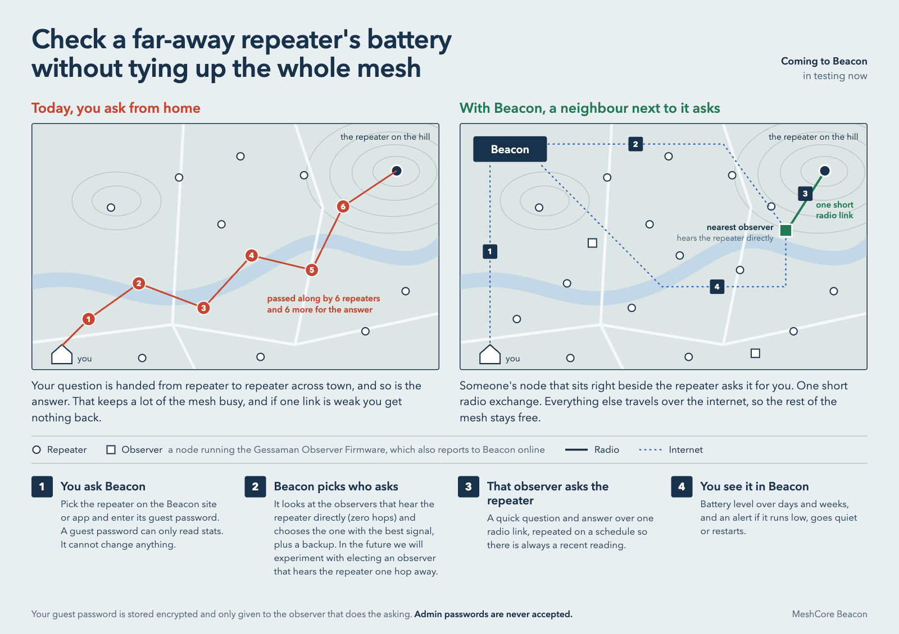

# Observer polling

!!! warning "Experimental"
    Polling runs on test firmware. Expect bugs, and don't put it on an observer
    you can't easily get to.

With polling on, an observer asks the repeaters right next to it for their
battery, temperature and status, and sends the answers to Beacon
(live.meshcore.ca) over the internet.



## Why it helps

Today, to check the battery on a far-away repeater, you log in from home. Your
request is passed along by every repeater in between, and so is the answer.
That keeps a lot of the mesh busy, and it often fails.

With polling, an observer that hears the repeater directly asks it for you. It
takes one short radio exchange.

## How it works

1. An observer with polling on registers with MeshCore Canada Beacon.
2. Someone with a Beacon account asks to have their repeater polled, and gives
   its guest password.
3. Beacon looks at the polling observers that hear that repeater directly (zero
   hops), picks the one with the strongest signal, and gives it the job.
4. About once an hour, that observer asks the repeater for its battery,
   temperature and status, and uploads the answers to Beacon.

So if you run a polling observer, it may poll a zero-hop neighbour for someone
else. If you run a repeater, you don't need a polling observer of your own:
one nearby is enough.

- **Guest passwords only.** A guest password can read stats and change nothing.
  Admin passwords are never accepted.
- **Direct neighbours only.** The observer only talks to repeaters it hears
  directly (zero hops), so nothing is added to the rest of the mesh.
- **A light touch.** At most two polls per repeater per hour, one at a time.

## What you need

- A board the polling firmware is built for. These are ESP32 boards with PSRAM
  (extra memory): Station G2, Station G3, Heltec V4 (including the expansion
  kit and R8 versions) and T-Beam S3 Supreme (SX1262). The Heltec V3 has no
  PSRAM, so it can't poll.
- Wi-Fi where the observer sits.
- Chrome or Edge on a computer, and a USB data cable.

## Before you start

The first flash of the polling firmware needs **Erase device**, which wipes
every setting on the board and its identity.

- Write down its radio settings, name and admin password.
- If the board is already in service, save its private key so it keeps its
  identity: send `get prv.key` and keep the reply in your password manager.
  [Back up a running repeater](../config/guide.md#back-up) has the steps.

## Set it up

The [setup tool](../config/index.md?type=observer) does all of this for you.
Pick **Repeater observer**, then **ESP32 with PSRAM**, then answer **Yes** when
it asks about observer polling. It gives you the flashing steps and every
command to paste.

To do it by hand:

1. Open the [observer flasher](https://observer.gessaman.com/) in Chrome or
   Edge.
2. Choose **MQTT Observer Firmware**, your board, then **Repeater**.
3. In **Version**, choose `v1.18.0.1-poll`. It isn't the newest in the list.
4. The first time, tick **Erase device**. Later updates keep your settings.
5. Flash it and wait for the board to restart.
6. Set it up as a repeater observer: radio, name, Wi-Fi and the two MeshCore
   Canada servers. [What each setting does](../config/guide.md#settings) lists
   those lines.
7. Turn polling on:

    ```text
    set poll.url https://live.meshcore.ca
    set poll.requests on
    set poll on
    ```

    `set poll.requests on` lets Beacon give your observer the repeaters that
    Beacon users ask to have polled.

Leave `poll.slot` and `poll.consent` alone. The observer finds the right MQTT
slot by itself.

Beacon sets the minimum time between polls; `set poll.interval` (default 60
minutes) can only make it slower. It takes 30 to 1440 minutes.

To always poll a repeater of your own, whatever Beacon asks for, add it by its
public key (64 characters). The observer has to hear it directly, and it holds
up to 8:

```text
poll add <repeater public key>
```

By default the observer tries a blank guest password, then `hello`. If a
repeater uses another guest password, set it:

```text
poll pw <repeater public key> set <guest password>
```

## Check it works

| Command | What you should see |
|---|---|
| `get poll` | Polling on, mode `telemetry`, an MQTT slot and the repeaters it polls |
| `get poll.status` | One line per repeater with its last result |
| `get poll.status 1` | Details for the first repeater: battery, temperature, next poll |
| `poll now <repeater public key>` | One poll right away (at most one a minute) |
| `get mqtt.status` | Ends with `poll:` and how many repeaters answered |

Readings show up on the repeater's page in Beacon, and the observer gets a
Poller tag.

## If nothing happens

- **`get poll` shows mode `unknown`:** Beacon hasn't answered yet. Check
  `poll.url` and that Wi-Fi is up. Nothing is polled until the observer has set
  its clock over Wi-Fi.
- **No slot:** no MQTT slot matches Beacon's servers. Check the MeshCore Canada
  servers in `get mqtt.status`.
- **`not_direct`:** the observer hasn't heard that repeater directly in the
  last day.
- **`login failed`:** the repeater doesn't accept a blank or `hello` guest
  login. Set its guest password with `poll pw`.
- **Polling stopped for one repeater:** if a repeater lets the observer in as
  admin, the observer stops polling it and gives up that access. Fix the
  repeater's passwords, then send `poll enable <repeater public key>`.

More help: [Troubleshoot an observer](troubleshooting.md).

## Undo: go back to the regular firmware

Turn polling off with `set poll off`.

The polling firmware updates itself from the polling test channel. To go back
to the regular observer firmware, send `ota branch beta`, then `ota update`.
