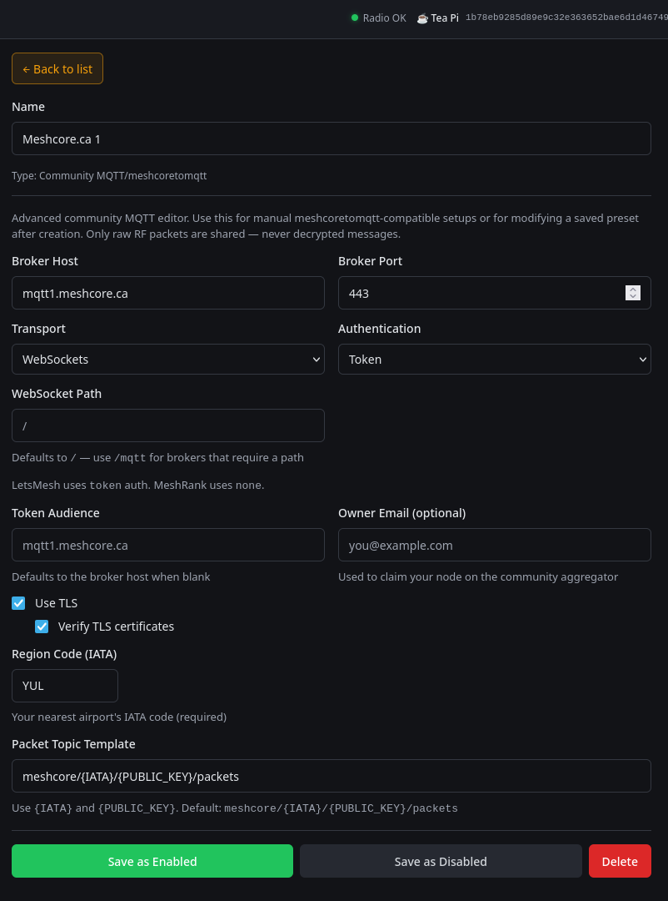

# Observer avec RemoteTerm

[RemoteTerm for MeshCore](https://github.com/jkingsman/Remote-Terminal-for-MeshCore)
peut transmettre les données de paquets d’une radio qu’il gère déjà. Il ne
déchiffre pas les messages privés.

## Ce qu’il vous faut

- RemoteTerm est installé à partir de sa source vérifiée.
- La connexion à la radio est stable.
- La radio utilise les paramètres du réseau maillé local.
- Vous avez choisi un véritable [code d’emplacement](../config/map.md).
- Vous avez lu [Données des observateurs et vie privée](data-collection-access.md).

## Configuration

Ouvrez **Settings** → **MQTT & Automation**, ajoutez
**Community MQTT / meshcoretomqtt**, puis entrez :

| Champ | Valeur principale |
|---|---|
| Name | `MeshCore.ca 1` |
| Broker Host | `mqtt1.meshcore.ca` |
| Broker Port | `443` |
| Transport | `WebSockets` |
| Authentication | `Token` |
| WebSocket Path | `/` |
| Token Audience | `mqtt1.meshcore.ca` |
| Use TLS | Enabled |
| Verify TLS certificates | Enabled |
| Region Code | Le code en majuscules sur la page [Trouver votre zone](../config/map.md) |
| Packet Topic Template | `meshcore/{IATA}/{PUBLIC_KEY}/packets` |

Laissez le champ facultatif de courriel du responsable vide, sauf s’il est
nécessaire à l’exploitation. Enregistrez l’entrée en la laissant activée.

Ajoutez une entrée de secours avec les mêmes valeurs, en ne modifiant que :

| Champ | Valeur de secours |
|---|---|
| Name | `MeshCore.ca 2` |
| Broker Host | `mqtt2.meshcore.ca` |
| Token Audience | `mqtt2.meshcore.ca` |

Utilisez le même code d’emplacement dans les deux entrées.

!!! note "Diffusion MQTT sous Windows"
    Si les instructions actuelles de RemoteTerm exigent l’option Uvicorn `--loop none` pour la diffusion MQTT sous Windows, utilisez cette option de lancement. Confirmez-la dans les instructions correspondant à la version de RemoteTerm installée.

## Vérifier { #check-in-corescope }

Votre observateur devrait apparaître en quelques minutes dans la [liste des observateurs](https://live.meshcore.ca/?tab=Observers), avec des paquets récents dans les [Live packets](https://live.meshcore.ca/). Être connecté ne prouve pas que les paquets sont arrivés : terminez avec [Vérifier votre observateur](verify.md). Il n’apparaît pas? Consultez le [dépannage](troubleshooting.md).

## Récupération

Désactivez ou supprimez seulement les deux entrées Community MQTT que vous avez
ajoutées. Ne supprimez aucune autre automatisation de RemoteTerm. Confirmez que
RemoteTerm gère toujours la radio normalement.

