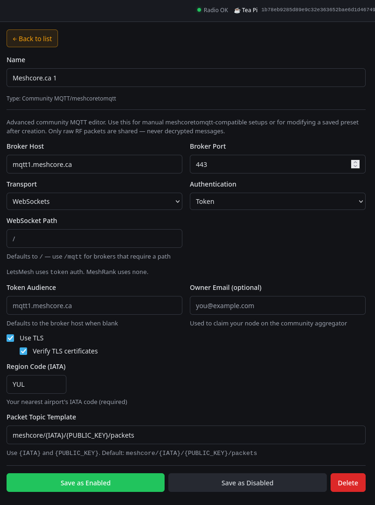

# Observe with RemoteTerm

[RemoteTerm for MeshCore](https://github.com/jkingsman/Remote-Terminal-for-MeshCore) can forward packet data from a radio it already manages. It does not decrypt private messages.

## You need { #before-you-start }

- RemoteTerm is installed from its reviewed upstream source.
- The radio connection is stable.
- The radio is on the local mesh settings.
- You chose a real [location code](../config/map.md).
- You read [Observer data, access, and privacy](data-collection-access.md).

## Set up

Open **Settings** → **MQTT & Automation**, add **Community MQTT / meshcoretomqtt**, and enter:

| Field | Primary value |
|---|---|
| Name | `MeshCore.ca 1` |
| Broker Host | `mqtt1.meshcore.ca` |
| Broker Port | `443` |
| Transport | `WebSockets` |
| Authentication | `Token` |
| WebSocket Path | `/` |
| Token Audience | `mqtt1.meshcore.ca` |
| Use TLS | Enabled |
| Verify TLS certificates | Enabled |
| Region Code | The uppercase code from the [Find your zone](../config/map.md) page |
| Packet Topic Template | `meshcore/{IATA}/{PUBLIC_KEY}/packets` |

Leave optional owner email blank unless it is operationally needed. Save the entry as enabled.

Add a backup entry with the same values, changing only:

| Field | Backup value |
|---|---|
| Name | `MeshCore.ca 2` |
| Broker Host | `mqtt2.meshcore.ca` |
| Token Audience | `mqtt2.meshcore.ca` |

Use the same location code in both entries.

!!! note "Windows MQTT fanout"
    If RemoteTerm's current upstream instructions require Uvicorn `--loop none` for Windows MQTT fanout, use that documented launch option. Confirm against the installed RemoteTerm version.

## Check it { #verify-in-corescope }

Your observer should show up within a few minutes in the [Live observer list](https://live.meshcore.ca/?tab=Observers), with recent packets in [Live packets](https://live.meshcore.ca/). A connected status is not proof that packets arrived, so finish with [Check your observer](verify.md). Not showing? See [Troubleshooting](troubleshooting.md).

## Recovery

Disable or remove only the two Community MQTT entries you added. Do not remove unrelated RemoteTerm automation. Confirm RemoteTerm still manages the radio normally.

