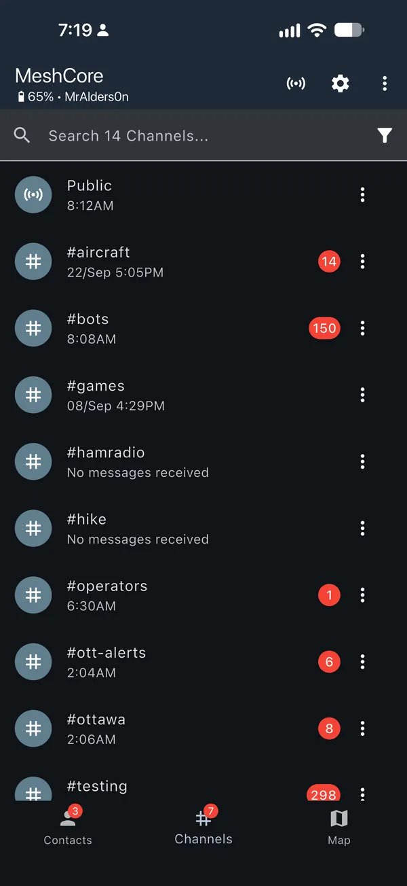
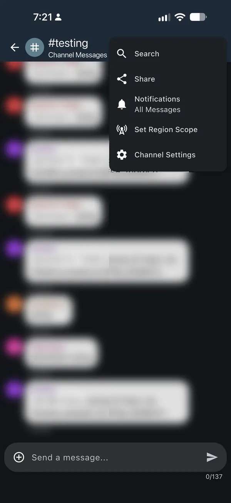
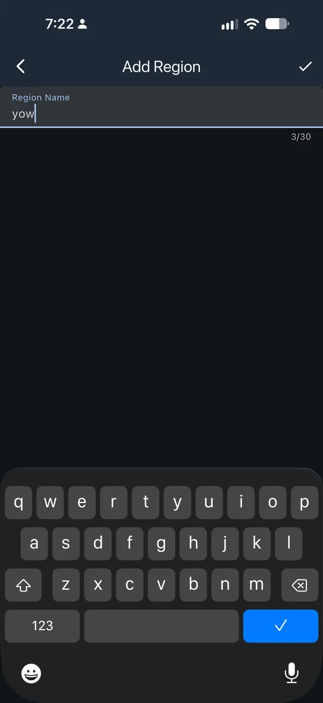
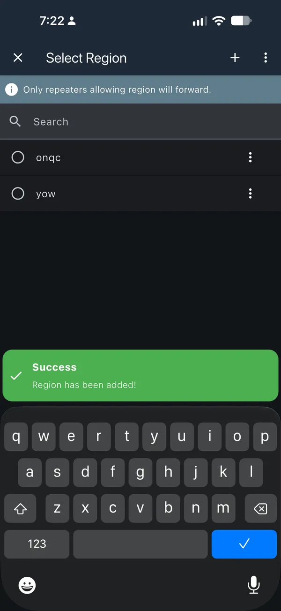
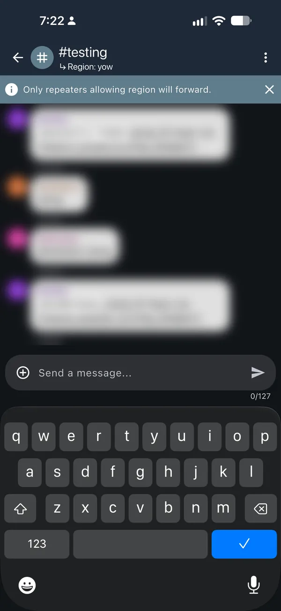

# How repeaters work

This page explains the ideas behind the [setup tool](index.md): what a repeater
does, how scopes and regions decide where messages go, and what each command in
the tool's list means. You don't need to read it first: the tool asks one
question at a time and explains every command as you go.

## What a repeater is {#what-a-repeater-is}

A repeater passes messages on so they reach further.

It's a MeshCore radio that stays switched on in one place, ideally up high on a
roof or a mast. Nobody chats on it. People chat on a **companion**: the small
radio they pair with the MeshCore app on their phone or computer. When a
repeater hears a message, it can send it out again, so it reaches people who
are too far away to hear the companion. Each repeater that passes a message on
is one **hop**.

Before it passes a message on, a repeater checks two things:

- **Is the message labelled for somewhere it serves?** Its region list decides
  that. See [Scopes and regions](#scopes-and-regions).
- **Has it gone too far already?** After 16 hops, no repeater passes it on.

Every device nearby has to use the same radio settings, or they can't hear each
other. Most of Canada uses the Canada radio settings; some local groups use
their own.

To set one up, use the [setup tool](index.md). For hardware and where to put it,
see [repeater devices](../hardware/recommended-repeaters.md) and
[mounting options](../hardware/repeater-mounting-options.md).

## What a repeater observer is {#repeater-observers}

A repeater observer is a repeater that also reports what it hears to
live.meshcore.ca, so everyone can see how the mesh is doing. It needs Wi-Fi to
do that.

That's why it needs an **ESP32** board: nRF52 boards have no Wi-Fi. It runs the
observer firmware from the [observer flasher](https://observer.gessaman.com/),
under MQTT Observer Firmware. Its reports go over your Wi-Fi to the two
MeshCore Canada servers, using MQTT (a common way for devices to send reports
to a server).

It works in one of two ways:

- **Repeat and observe:** a full repeater that also reports what it hears. Most
  people pick this.
- **Listen only:** it reports what it hears to live.meshcore.ca but never passes
  anything on.

Either way it reports what it hears. Listen only is handy indoors or next to
another repeater, where repeating would only add noise. You can switch later
with `set repeat on` or `set repeat off`.

A repeater observer is one kind of observer. Others use RemoteTerm, Home
Assistant or a small computer next to a radio:
[Set up a network observer](../analyzer/intro.md) helps you choose one.
[Observer data and privacy](../analyzer/data-collection-access.md) explains
what the reports contain.

## Scopes and regions {#scopes-and-regions}

**A scope is a label on a message saying how far it should travel. A region list
is the labels a repeater agrees to pass on.**

That's the whole idea. For example:

- **A message labelled `ytr` stays around Belleville.** Repeaters in Quinte
  West have `ytr` on their list, so they pass it on. Kingston's repeaters
  don't, so it stops there.
- **A message labelled `on` crosses Ontario**, because every Ontario repeater
  has `on` on its list.

### One code, two names

The same short codes show up in two places:

- **On a message, the label is a scope.** You set it on your companion and on
  each channel. The MeshCore app calls it a *region scope*.
- **On a repeater, the labels it passes on are its regions**, kept in its
  region list.

A region is also the area a repeater serves. Regions are named after the
nearest airport code: Belleville is in `ytr`, Quinte West. A repeater's region
decides which messages it passes on.

### Which region is mine?

The [setup tool](index.md) finds it from the town, street address or
coordinates where the repeater will be, and the [region map](map.md) shows them
all. Coordinates aren't sent to any search; a town or street address is looked
up with the Government of Canada's place search (geo.ca).

- **Near a provincial border, pick the side it's really on.** The `yow` region
  crosses the Ottawa River: an Ottawa repeater has `yow` and `on`, a Gatineau
  repeater `yow` and `qc`. A street address or coordinates settle it.
- **Towns in the same region share its code.** Ottawa and Gatineau are both
  `yow`.
- **No zone for your area?** [MeshMapper](https://meshmapper.net/), the
  community map that draws each region's area, doesn't cover everywhere. The
  region map then shows a MeshCore Canada [starter region](#starter-regions)
  instead.
- **Write codes in lowercase.** You can search for `YTR`, but on the air `ytr`
  and `YTR` are two different labels.

### The five labels

From smallest to largest:

| Label | Example | What it covers |
| --- | --- | --- |
| Region | `ytr`, `yow`, `yhz` | One area, named after its airport code |
| Province or territory | `on`, `qc`, `ns` | The province the repeater is in |
| Ontario + Québec | `onqc` | Both provinces, as one shared mesh |
| Canada | `can` | All of Canada. On every list, not used yet |
| North America | `na` | Canada and the US. On every list, not used yet |

A Belleville repeater has `ytr`, `on`, `onqc`, `can` and `na`. A Halifax repeater
has `yhz`, `ns`, `can` and `na`: `onqc` is only for Ontario and Québec.

`can` and `na` are on every list so that Canada-wide or cross-border messages
can work one day without anyone setting up their repeater again. Don't use them
on your companion or channels yet: on their own, they don't make a message reach
another province or country.

**Each label stands alone.** The labels go from small to large, but they don't
sit inside each other: having `on` doesn't mean having `ytr`. Each label has
to be on the list by itself, which is why the setup tool puts every one that
applies on every repeater.

### How a repeater decides

When a message reaches a repeater, the repeater compares its label with its list:

- **The label is on its list:** it passes the message on.
- **The label isn't on its list:** it doesn't.
- **No label at all:** the message counts as `*`, the star that stands for "no
  label". It's passed on only if `*` is allowed, which city repeaters do and
  edge repeaters don't. Older apps send messages with no label, and so does a
  companion with no default scope.
- **Too many hops:** after 16 hops it stops, whatever its label.

A Belleville city repeater's list is `*`, `ytr`, `on`, `onqc`, `can` and `na`. So:

| Message | Label | Belleville city repeater |
| --- | --- | --- |
| Belleville test channel | `ytr` | Passes it on |
| First message to a friend in Montréal | `onqc` | Passes it on |
| Someone on an older app | none | Passes it on |
| Kingston channel | `ygk` | Doesn't pass it on |
| Québec-wide channel | `qc` | Doesn't pass it on |

The repeater still hears every message: its list only decides which ones it
passes on. Your companion receives everything that reaches it.

A few details catch people out:

- **Spelling must be exact.** `ytr`, `YTR` and `quinte` are three different labels.
- **Only messages that spread out are checked.** Channel messages, and the first
  direct message to a contact, spread out through every repeater that will pass
  them on. This is called a *flood*. Once a direct message has a known path, it
  follows that path and labels no longer matter.
- **A repeater with no regions set passes on only messages with no label.**
  A labelled message only travels once the repeaters along the way have its label.
- **A label isn't a lock or a fence.** Anyone can put any label on a message,
  and it doesn't check where you are. It only tells repeaters whether to pass the
  message on.

### Who passes on what

Here's a stretch of mesh from Belleville to Kingston, with an edge repeater in
between:

- **Belleville city repeaters** have `*`, `ytr`, `on`, `onqc`, `can` and `na`.
- **The edge repeater** has `ytr`, `ygk`, `on`, `onqc`, `can` and `na`, but not `*`.
- **Kingston city repeaters** have `*`, `ygk`, `on`, `onqc`, `can` and `na`.

Does each repeater pass the message on?

- **No label, sent in Belleville:** Belleville passes it on. The edge repeater
  doesn't, so Kingston isn't reached. It stays around Belleville.
- **`ytr`, a Belleville channel:** Belleville and the edge repeater pass it on.
  Kingston's repeaters don't, so it stops there.
- **`ygk`, a Kingston channel:** the edge repeater and Kingston pass it on.
  Belleville doesn't, so it stays around Kingston.
- **`on`, an Ontario channel:** all three pass it on, so it goes across
  Ontario.
- **`onqc`, a companion's default:** all three pass it on, so it goes across
  Ontario and Québec.

This shows which repeaters pass a message on, not radio coverage. Anyone in
range of a repeater still hears what it sends, and real meshes have more paths
than this.

### Try it: which towns does a label reach? {#scope-demo}

This example shows which towns' city repeaters pass on a message, for each label
you could put on it.

<div data-scope-demo></div>

<noscript><p>The example needs JavaScript to run. The table and list above show the same idea.</p></noscript>

### Why airport codes?

- **MeshMapper already uses them**, for example `ytr.meshmapper.net`.
- **MeshCore already uses them elsewhere**, such as the
  [location code every observer reports](../analyzer/iata-codes.md). A second
  set of names just for regions would only add confusion.
- **There are no accents or capital letters to get wrong.** `montréal`,
  `Montreal` and `montreal` would be three different labels.
- **They're easy to split later.** If a town wants its own area one day, it can
  use its own airport code and still keep its province and `onqc`.

The code names the area, not the airport. The codes come from IATA, the airline
industry group that assigns airport codes, which is why the map calls these
IATA regions.

### Reading a `region def` line

You don't need this to set up a repeater: the tool gives you the exact line. It
helps when you want to read one.

```text
region def ytr|* on|* onqc|* can|* na
```

`region def` builds the repeater's list in one line. It adds each name in turn,
and `|*` means "go back to the top" before the next one, so the names end up side
by side, not inside each other. Send `region` afterwards to see the list:

```text
*^ F
 ytr F
 on F
 onqc F
 can F
 na F
```

- **`F`** means it passes those messages on.
- **The `*` line** is for messages with no label. It has `F` on a city repeater
  and no `F` on an edge repeater.
- **`^`** marks its home region. On a new repeater it sits on `*`. You can
  ignore it.

`region def` only adds names. It never removes the ones already there, so a
repeater that's already running has its old regions cleared first: see
[Clearing old regions](#old-regions). Firmware older than 1.16 builds the same
list one name per line: see [Older firmware](#older-firmware).

### How messages find their way between cities {#route-discovery}

You don't need to hear every repeater along the way to message someone in
another city. The first direct message to a contact, before a path is known,
spreads out through the mesh with your **default scope**. The reply that tells
your companion the path comes back with **your contact's** default scope. After
that, messages follow the saved path and labels no longer matter.

So both default scopes have to be labels the repeaters in between pass on.
Repeaters set up with the tool in Ontario and Québec all have `onqc`, so it works
between Belleville and Montréal in both directions. A region label like `ytr`
stops at the first repeater without it, just outside Quinte West, and a message
with no label stops at the first edge repeater. That's why companions set a default scope: see
[Companion scopes](#companions).

You still need your contact's details and working radio links between you. The
[MeshCore FAQ](https://github.com/meshcore-dev/MeshCore/blob/main/docs/faq.md#54-q-how-does-a-node-discover-a-path-to-its-destination-and-then-use-it-to-send-messages-in-the-future-instead-of-flooding-every-message-it-sends-like-meshtastic)
explains how paths are found.

## What each setting does {#settings}

The setup tool explains every command in its list in one sentence. These are the
same explanations, all in one place. The examples are for a repeater in
Belleville, whose region is `ytr` (Quinte West). Your list uses your own town,
region and name.

You paste the commands one at a time into the flasher's Console, or send them
from the repeater's Command Line in the MeshCore app. Most answer `OK`. Lines
with words between `<` and `>` are ones you type yourself: the tool never asks
for your passwords, so it can't copy them for you.

### Basics

`set radio 910.525,62.5,7,5`
:   Use the Canada radio settings: 910.525 MHz, 62.5 kHz, spreading factor 7, coding rate 5. Every device nearby has to match.

`set radio 910.425,62.5,7,5`
:   Use the BC Mesh radio settings: 910.425 MHz, 62.5 kHz, spreading factor 7, coding rate 5. Every device nearby has to match.

    The tool asks which settings to use only where a local group, such as BC
    Mesh in British Columbia, uses its own.

When you send the commands from your phone, the radio line is left out:
changing the radio settings from your phone would cut off the connection you're
using.

`set name Belleville_R1`
:   The name other people see.

    Keep it to about 30 letters (accented letters count as two). Spaces are
    fine, but not `[ ] \ : , ? *`: the repeater won't accept them.

`set lat 44.1628`
:   Show it on maps at the spot you picked. This line sets the latitude.

`set lon -77.3832`
:   This line sets the longitude, so maps show it at the spot you picked.

    The tool shows a map with a pin where you said it will be installed. Drag
    it, tap the map, or type the coordinates. Most people pick a spot a block
    or two from the repeater. Tick **Disable location** and both lines are left
    out, so maps won't show it.

`password <your new admin password>`
:   Set the admin password you'll use to manage it from the app. Keep it in your password manager.

`password <your new admin password>`, on a repeater that's already running
:   Change the admin password, or skip this line to keep the current one. Keep it in your password manager.

### MeshCore Canada settings

The tool gives these four to every repeater, so repeaters across the mesh behave
the same way. An *announcement* (advert) is how a device tells others it exists.
These save by themselves.

`set path.hash.mode 2`
:   Use longer repeater IDs (3 bytes) in the list of repeaters a message went through, so fewer repeaters share an ID.

`set advert.interval 240`
:   Announce itself to repeaters in direct range every 4 hours.

`set flood.advert.interval 47`
:   Announce itself across the wider mesh every 47 hours.

`set flood.max 16`
:   Never pass on a message after 16 hops (each repeater that passes it on is one hop).

### Scopes

The scope lines for a Belleville city repeater on firmware 1.16 or newer:

`region def ytr|* on|* onqc|* can|* na`
:   Pass on messages labelled for Quinte West (ytr), Ontario (on), Ontario + Québec (onqc), Canada (can) and North America (na).

`region allowf *`
:   Also pass on messages with no label, as a city repeater does.

`region denyf *`
:   Don't pass on messages with no label, so they stay in their own region. That's what makes it an edge repeater.

    An edge repeater gets this line instead of `region allowf *`.

`region default ytr`
:   Label this repeater's own announcements with ytr.

`region save`
:   Save the region settings.

### Back up a running repeater {#back-up}

A repeater that's already running has an identity: its private key. Other
devices know it by that key, and it can't be recreated if it's lost. Before you
flash it, back it up:

1. Write down its name and admin password.
2. To save its private key, in the MeshCore app open the repeater from Contacts,
   log in as admin, tap Command Line and send `get prv.key`. Or connect it by
   USB, open the Console in the [MeshCore flasher](https://flasher.meshcore.io/)
   and send the same command. Keep the reply in your password manager and never
   paste it anywhere shared.
3. Never erase it in the flasher.

If flashing wipes it anyway, for example when you switch to the observer
firmware, put the key back. Right after flashing, while it's still plugged in,
send `set prv.key <saved key>` in the flasher's Console, then `reboot`. Put the
key you saved in place of `<saved key>`. You can also do it later from the app's
Command Line if you can log in as admin; if you can't, plug it in by USB and use
the flasher's Console. Both commands are in the
[MeshCore command reference](https://docs.meshcore.io/cli_commands/#view-or-change-this-nodes-identity-private-key).

Never share the private key: anyone who has it can pose as your repeater.

### Clearing old regions {#old-regions}

A repeater that's already running may still have regions from an older setup.
`region def` doesn't remove them, so the tool's list clears them first.

`region`
:   Show the regions it has now. Paste the reply into the setup tool to clear the old ones.

`region remove ott`
:   Remove the old region ott.

`region home ytr`
:   Make ytr its home region, since its old home region is being removed.

    This line only appears when the `^` home marker was on one of the old regions.

The tool removes the most indented names first and never removes `*`. If
`region remove` answers `Err - not empty`, another name is still indented under
it: remove that one first, then try again. `Err - not found` means it's already
gone, which is fine.

From the app, a long reply can be cut short. If the list looks cut off, or the
repeater has many regions, run `region` over USB instead, in the flasher's
Console.

### Older firmware {#older-firmware}

Firmware 1.16 and newer builds the whole list with one `region def` line. Older
versions add one name per line, so these lines repeat for each label.

**Firmware 1.15:**

`region put ytr`
:   Pass on messages labelled for Quinte West (ytr).

**Firmware 1.14:**

`region put ytr`
:   Add Quinte West (ytr) to its list of regions. It doesn't pass those messages on until its `region allowf` line.

`region allowf ytr`
:   Pass on messages labelled for Quinte West (ytr).

Firmware 1.14 has no `region default`, so the repeater's own announcements carry
no label. Updating is worth it. Below 1.14, region settings don't work: update
the firmware first.

### Repeater observer

These lines are only for a repeater observer.

`set mqtt.iata YTR`
:   Tell live.meshcore.ca which region it reports from.

    It's the region code, in capitals.

`set wifi.powersave none`
:   Keep Wi-Fi awake so reports aren't delayed.

`set mqtt1.preset meshcore-ca-1`
:   Report to the main MeshCore Canada server. This replaces whatever is in MQTT slot 1, the first of its saved server connections.

`set mqtt2.preset meshcore-ca-2`
:   Report to the backup MeshCore Canada server too. This replaces whatever is in MQTT slot 2, the second of its saved server connections.

    If this board already reports to another network in those slots, use the
    observer flasher's Configure via USB to put MeshCore Canada in free slots
    (3 to 6) instead.

`set mqtt.status on`
:   Send a short status report when it connects and every few minutes, so live.meshcore.ca shows it as online.

`set mqtt.packets on`
:   Report the packets (radio messages) it hears. This is the main thing it sends to the servers.

`set mqtt.raw off`
:   Don't also send a raw copy of each packet. The servers don't need it.

`set mqtt.rx on`
:   Include the packets it receives over the radio.

`set mqtt.tx advert`
:   Of the packets it sends itself, report only its own announcements.

`set bridge.enabled on`
:   Turn on sending over Wi-Fi. This is the main switch for everything it reports.

`set repeat on`
:   Also pass messages on, as a full repeater.

`set repeat off`
:   Listen only: never pass messages on.

`advert`
:   Announce itself now, so nearby devices see it straight away.

`set wifi.ssid <your Wi-Fi name>`
:   Your 2.4 GHz Wi-Fi network. Type its name exactly, without quotes.

`set wifi.pwd <your Wi-Fi password>`
:   Your Wi-Fi password. Never paste this anywhere shared.

### Finish

`reboot`
:   Restart so every setting takes effect.

After it restarts, the tool lists a few checks, such as `ver` and `region`. They
only show its settings. The one exception is `clock sync`, which sets its clock
from your phone: after a restart its clock is often wrong, and phones may ignore
its announcements until it's set. Send it from the MeshCore app. It doesn't work
from the Console: there the repeater only answers that its clock can't go
backwards.

### Loop detection {#loop-detection}

The tool doesn't change this setting. Firmware 1.14 and newer can drop packets
that keep coming back through the same repeater, which can calm a flood of
repeated packets. Change it only with your local operators: write down the
current value with `get loop.detect`, set it with, for example,
`set loop.detect moderate`, and put the old value back if messages start going
missing. See the
[MeshCore command reference](https://docs.meshcore.io/cli_commands/#view-or-change-this-nodes-loop-detection).

## City or edge repeater {#city-or-edge}

Edge repeaters regularly hear repeaters in another region, for example one
between Belleville and Kingston. City is every other repeater, even on the
outskirts. Edge repeaters stop messages with no label from spilling into the
next region.

The difference is what they do with messages that have no label:

- **A city repeater passes them on** (`region allowf *`), so people nearby who
  haven't set a scope are still heard.
- **An edge repeater doesn't** (`region denyf *`). It also has the codes of the
  neighbouring regions it hears, so labelled messages for either side get
  through.

Belleville, city repeater:

```text
region def ytr|* on|* onqc|* can|* na
region allowf *
region default ytr
```

Belleville, edge repeater that also hears Kingston (`ygk`):

```text
region def ytr|* ygk|* on|* onqc|* can|* na
region denyf *
region default ytr
```

### Why it matters

Without edge repeaters, every message with no label would spread from town to
town across the whole mesh, crowding the radio channel everywhere. Edge repeaters keep
that local chatter in its own region, while labelled messages still travel as
far as their label says.

### Is mine an edge repeater?

- **Being near a boundary isn't enough.** What counts is which repeaters it
  regularly hears.
- **Check its neighbours on [MeshMapper](https://meshmapper.net/).** Click your
  repeater to see the repeaters it hears, with how often and how recently each
  link was seen. Several neighbours in another region, heard often and
  recently, make it an edge repeater. A single link seen a few times, or not
  for weeks, doesn't count.
- **Towns that share a code are one region.** Ottawa and Gatineau are both
  `yow`, so a repeater between them is a city repeater.
- **Think twice if it's the only repeater around.** An edge repeater doesn't
  pass on messages from people nearby who haven't set a scope.
- **Every repeater linking the same two regions should be an edge repeater.**
  Otherwise messages with no label go around through the one that isn't.

An edge repeater lists the neighbouring regions it regularly hears. It will also
carry messages labelled for these. They're optional: without them, it still
passes on `on`, `onqc` and the other wider labels. The tool lists the five
regions nearest to your repeater first, with how far each is, and has a box to
find any other region.

### Labels shared across the border {#cross-border-scopes}

Some repeaters link with a network in the United States. For those, the tool
offers agreed scopes: labels that operators on both sides have agreed to carry.
It shows the ones that suit your province, each with a short description. City
and edge repeaters can both use them. For example, `onny` is for repeaters that
connect Ontario and New York.

You can also tick **Another scope we've agreed with a network across the
border**, for any repeater in any province. Type the scope name exactly as you
both agreed it (lowercase letters, numbers and dashes).

Only tick one if this repeater links with that network and its operators have
agreed. Not sure? Leave them off.

Using a cross-border scope that isn't listed? [Share it with us](../submit-idea.md) so it can be added to the tool.

### Still too noisy?

If messages with no label are still too noisy inside a region, repeaters can
also limit how far they travel with `set flood.max.unscoped 3`. Labelled
messages keep the 16-hop limit. The tool doesn't add this line: only use it if
your local operators agree.

## Companion scopes {#companions}

Your companion puts a scope on what you send. Each channel can have its own,
and everything else uses your **default scope**.

!!! note "Set your default scope now"
    Repeaters set up with the [meshcore.ca setup tool](index.md) pass messages
    on by scope. Edge repeaters don't pass on messages that have no scope, so
    without a default scope your messages may not reach beyond your own area.

    - **Ontario or Québec:** use `onqc`.
    - **Elsewhere:** use your province's code, such as `ns` or `bc`, unless
      your community has agreed on something else.

In the MeshCore app, version 1.43 or newer, it's under
**Settings → Network Settings → Default Region Scope**. The
[companion guide](../start/companion.md#set-your-default-scope) shows each step
with screenshots.

**Why `onqc`?** You can't give a single direct message its own scope. The first
one to a contact uses your default scope, and the reply that sets up the path
uses your contact's (see
[How messages find their way between cities](#route-discovery)). `onqc` is
passed on across both provinces, so it works between any two cities there.
Elsewhere there's no label shared between provinces, so your province's code is
the widest one in use. Don't use `can` or `na` yet.

### Scope a channel

A channel with no scope of its own uses your default scope. To give a channel
its own, pick its label from this table, then follow the steps below.

| Channel | Scope |
| --- | --- |
| `Public` | `onqc` in Ontario and Québec; your province's code elsewhere |
| Test channels, such as `#testing` | Your region, such as `ytr` |
| Bot channels, such as `#bots` | Your region |
| Your own channels | Your region, your province or `onqc`, as the people using it agree |

Do this for each channel. The screenshots set `#testing` to `yow`; use your
own label instead.

1. Tap **Channels** in the bottom menu bar and open the channel.

    [{ loading=lazy width="300" height="652" }](../assets/images/onqc-scopes/companion-07-channels.webp)

2. Tap **⋮** in the top right and choose **Set Region Scope**.

    [{ loading=lazy width="300" height="652" }](../assets/images/onqc-scopes/companion-13-testing-menu.webp)

3. If your label isn't listed, tap **+**, type it (for example `yow`) and tap the
   **checkmark**.

    [{ loading=lazy width="300" height="652" }](../assets/images/onqc-scopes/companion-15-add-yow.webp)

4. If you added one, you'll see **Region has been added!** Tap your label to
   select it.

    [{ loading=lazy width="300" height="652" }](../assets/images/onqc-scopes/companion-16-yow-added.webp)

5. The header now shows **Region: yow**. Only repeaters with that label on their
   region list pass this channel's messages on.

    [{ loading=lazy width="300" height="652" }](../assets/images/onqc-scopes/companion-17-testing-scoped.webp)

Scoped messages are a little shorter: the app allows fewer characters per
message. On `Public`, the limit dropped from 137 to 127 characters in our
testing.

### Bots and MeshMapper {#bots-and-meshmapper}

Bots and [MeshMapper](https://meshmapper.net/) use their region's label, such as
`ytr`, so their messages stay in their own area.

- **Bots:** on the bot's companion, set **Default Region Scope** to your region
  code, the same way as above. Set the channels it posts in to your region too.
- **MeshMapper:** use your region code as the scope for its messages.

A labelled message only travels through repeaters that have its label, so check
that the repeaters around you have been set up with it.

## Starter regions {#starter-regions}

Where MeshMapper has no zone yet, MeshCore Canada fills the gap with a starter
region. Starter regions use real airport codes and work like any other region,
but they're **not MeshMapper zones, and they don't claim radio coverage**. The
map draws them with dashed gold outlines. Check with local operators before
relying on one.

| Area | Region | Code from |
| --- | --- | --- |
| Prince Edward Island | `yyg` | [Charlottetown](https://flyyyg.com/) |
| Newfoundland | `yyt` | [St. John's](https://stjohnsairport.com/) |
| Labrador | `yyr` | [Happy Valley–Goose Bay](https://goosebayairport.com/) |
| Yukon | `yxy` | [Whitehorse](https://yukonairports.ca/contact-information) |
| Northwest Territories | `yzf` | [Yellowknife](https://tc.canada.ca/en/aviation/operating-airports-aerodromes/list-airports-owned-transport-canada) |
| Nunavut | `yfb` | [Iqaluit](https://tc.canada.ca/en/aviation/operating-airports-aerodromes/list-airports-owned-transport-canada) |

In the other provinces, these hubs fill the remaining gaps:

| Province | Starter regions |
| --- | --- |
| BC | `ylw` Kelowna, `yxs` Prince George, `yxt` Terrace, `yxc` Cranbrook |
| AB | `ymm` Fort McMurray, `yqu` Grande Prairie |
| SK | `yxe` Saskatoon, `yqr` Regina |
| MB | `ybr` Brandon, `yth` Thompson, `yyq` Churchill |
| ON | `ysb` Sudbury, `yam` Sault Ste. Marie, `yts` Timmins, `yqk` Kenora |
| QC | `yvo` Val-d’Or, `yzv` Sept-Îles, `yvp` Kuujjuaq |
| NB | `yqm` Moncton, `yfc` Fredericton |
| NS | `yqi` Yarmouth |

Land that no region covers goes to the closest regional centre in its province:
a MeshMapper region or one of the hubs above.

A repeater in Charlottetown has `yyg`, `pe`, `can` and `na`; one in Whitehorse
has `yxy`, `yt`, `can` and `na`. Neither uses `onqc`. The [setup tool](index.md)
gives the commands.

### Planning extensions {#planning-extensions}

A gap right next to a MeshMapper region can use that region's code as a
**planning extension**. For example, the Wingham-area point `43.8678, -81.2619`
is in `ykf`, not Sudbury's `ysb`. Goderich is in `yxu`, and Kincardine in `ylk`.

Extensions are separate dashed areas on the map. They don't change MeshMapper's
zones, and the map says which kind of area your point is in. Like starter
regions, they need local review and don't show measured radio coverage.

Starter regions and extensions are broad starting points, not a promise that
distant towns can hear each other. MeshMapper's zones always come first: ask in
[MeshMapper](https://meshmapper.net/) to add or change a zone. To suggest a
change to a starter region or an extension,
[send a community proposal](../submit-idea.md).

The outlines follow Statistics Canada's province and territory boundaries.
Labrador is census divisions 10 and 11; Newfoundland is the rest of the province.

## Sources

- [MeshMapper](https://meshmapper.net/), and the snapshot details in the map's
  **Region data** view
- [MeshCore command reference](https://docs.meshcore.io/cli_commands/)
- [Data and licence notice](../assets/regions/NOTICE.txt)
