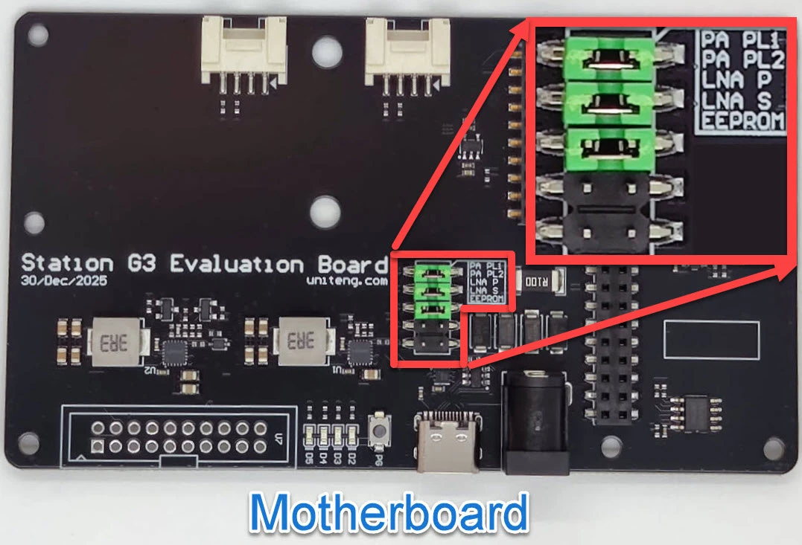

# Configurer une Station G3

Par **MrAlders0n (Ottawa)** · **19 octobre 2026**

La Station G3 est une station de base LoRa haute puissance dotée d’un amplificateur d’émission (PA) et d’un amplificateur de réception (LNA) externes. Des cavaliers sur la carte mère règlent leur fonctionnement. Cette page décrit la configuration propre à la G3 que nous utilisons : PA et LNA contrôlés par le micrologiciel, et environ 30 dBm (1 W) en sortie. Terminez ensuite la configuration comme répéteur ou comme observateur.

**Carte :** Station G3 de BQ Voyage / UnitEng avec la carte MCU ESP32-S3<br>
**Micrologiciel :** MeshCore v1.17.1 ou plus récent, ou le micrologiciel d’observateur MQTT<br>
**Sortie :** niveau de puissance 2 avec `set tx 16`, environ 30 dBm

## Avant de commencer

!!! danger "Antenne et alimentation"
    **Branchez l’antenne avant de mettre sous tension. Utiliser la carte sans antenne peut l’endommager définitivement.** Alimentez la G3 par la prise barillet avec une source de 9 à 19 V c.c. d’au moins 25 W, ou avec une alimentation USB-C PD de 15 V. Ne dépassez jamais 19 V. Le port USB-C de la carte MCU sert uniquement aux données et ne peut pas alimenter la G3.

!!! warning "Vérifiez votre puissance de sortie"
    La G3 peut émettre plusieurs watts. 30 dBm correspond à 1 W au port d’antenne, avant les pertes de câble et le gain d’antenne. Le gain d’antenne s’ajoute à la puissance rayonnée : vérifiez les [règles actuelles d’ISDE](../resources/links.md#radio-and-regulatory-references) pour l’ensemble de votre installation.

- Installez un micrologiciel pour la Station G3. Pour un répéteur, choisissez **UnitEng/BQ Voyage Station G3** dans l’[outil d’installation MeshCore](../meshcore/flash-repeater.md). Pour un observateur, choisissez **Station G3 (ESP32)** dans l’[outil d’installation de l’observateur MQTT](../analyzer/builds/mqtt-firmware.md). N’utilisez une version **(2nd RF slot)** que si la carte LoRa est dans le deuxième emplacement RF, ce qui n’est pas la configuration par défaut.
- Ayez un câble de données USB-C pour la carte MCU afin d’utiliser la console.

## Fonctionnement des niveaux de puissance

Avec MeshCore, nous recommandons de retirer les cavaliers **PA PL1** et **LNA P** pour que le micrologiciel les contrôle. Le PA offre alors quatre niveaux de puissance, du niveau 1 (le plus faible) au niveau 4 (le plus élevé), réglés par le cavalier **PA PL2** et `radio.fem.txgain` :

<div class="mc-table-wrap" markdown>

| Cavalier PA PL2 | `txgain off` | `txgain on` |
|---|---|---|
| Retiré | Niveau 1 | Niveau 3 |
| Installé | Niveau 2 | Niveau 4 |

</div>

Le niveau 4 exige une alimentation d’au moins 10 V. Une nouvelle valeur de `txgain` est enregistrée immédiatement, mais n’est appliquée au matériel qu’au début de la prochaine émission. D’ici là, `get radio.fem.txgain` peut afficher la nouvelle valeur avant que la carte ait changé de niveau.

### Choisir le réglage TX

`set tx` règle la sortie de la puce radio SX1262, qui alimente le PA. Ce n’est pas la puissance à l’antenne. Sortie typique mesurée par le fabricant à 915 MHz, en dBm :

<div class="mc-table-wrap" markdown>

| `set tx` | Niveau 1 | Niveau 2 | Niveau 3 | Niveau 4 |
|---|---|---|---|---|
| 7 (par défaut) | 21,7 | 22,2 | 23,1 | 23,3 |
| 14 | 27,7 | 28,4 | 29,4 | **29,7** |
| 15 | 28,4 | 29,2 | **30,2** | 30,6 |
| 16 | 29,2 | **30,0** | 31,0 | 31,5 |
| 18 | **30,5** | 31,4 | 32,6 | 33,3 |
| 22 | 32,8 | 34,1 | 35,6 | 36,8 |

</div>

Les valeurs en gras sont les réglages que le fabricant indique pour la bande US915; elles sont toutes proches de 30 dBm. Ces valeurs sont typiques et ne constituent pas une spécification : prévoyez environ ±2 dB. Ne reprenez pas `set tx 22` d’un guide générique : sur une G3, cela donne de 33 à 37 dBm.

## Configuration

### 1. Régler les cavaliers

Mettez la G3 hors tension. Le bloc de cavaliers se trouve à côté du connecteur de la carte MCU, sur la carte mère, et porte les mentions PA PL1, PA PL2, LNA P, LNA S et EEPROM.

[{ .mc-build-photo width="600" height="408" loading=lazy }](images/station-g3-jumpers.webp)

Photo : [BQ Voyage](https://wiki.bqvoy.com/devkits/station-g3). PA PL1, PA PL2 et LNA P sont installés sur cette photo; avec MeshCore, retirez PA PL1 et LNA P.

<div class="mc-table-wrap" markdown>

| Cavalier | Réglage | Pourquoi |
|---|---|---|
| PA PL1 | **Retiré** | Le micrologiciel le règle avec `radio.fem.txgain` |
| PA PL2 | **Installé** | `txgain` bascule alors entre les niveaux 2 et 4 |
| LNA P | **Retiré** | Le micrologiciel active le LNA en réception et le coupe pendant l’émission |
| LNA S | Retiré | Réservé |
| EEPROM | Retiré | Réservé |

</div>

LNA P fonctionne à l’inverse de ce qu’on pourrait croire : un cavalier installé force le LNA à l’**arrêt**.

!!! info "Le micrologiciel ne voit pas les cavaliers"
    Si PA PL1 est encore installé, `set radio.fem.txgain off` répond `OK`, mais la carte reste au niveau le plus élevé. Retirez le cavalier plutôt que de compter sur la commande.

### 2. Régler les amplificateurs et la puissance TX

Remettez la G3 sous tension, ouvrez la console par USB et exécutez :

```text
set radio.fem.txgain off
set radio.fem.rxgain on
set tx 16
```

Avec PA PL2 installé, vous obtenez le niveau 2 à environ 30 dBm. Pour un autre niveau, utilisez les tableaux ci-dessus.

`radio.fem.rxgain` contrôle le LNA externe de la G3. Ce réglage est distinct de `radio.rxgain`, qui contrôle le gain de réception de la puce radio elle-même.

## Vérifier la configuration

```text
get radio.fem.txgain
get radio.fem.rxgain
get tx
```

Vous devriez voir `off`, `on` et `16`.

## Dépannage et récupération

- **`Error: unsupported` :** le micrologiciel n’est pas une version pour la Station G3, ou est antérieur à MeshCore v1.17.1. Réinstallez une version pour la Station G3.
- **La sortie reste élevée après `txgain off` :** PA PL1 est encore installé.
- **Réception faible :** vérifiez que LNA P est retiré et que `get radio.fem.rxgain` affiche `on`. Couper le LNA peut aider sur un site où le bruit de fond est élevé.
- **Redémarrages pendant l’émission :** l’alimentation ne suffit pas. Utilisez une source d’au moins 25 W, d’au moins 10 V pour le niveau 4, ou passez à un niveau inférieur.
- **Revenir au contrôle par cavaliers seulement :** mettez hors tension et réinstallez PA PL1 pour les niveaux 3 ou 4. Ne réinstallez LNA P que si vous voulez couper le LNA.

## Terminer la configuration

Les réglages propres à la G3 sont terminés. Poursuivez avec la configuration du rôle de ce nœud :

- **Répéteur :** [Configurer le répéteur](../meshcore/flash-repeater.md#configurer-le-repeteur), puis [configurer ses régions](../config/index.md).
- **Observateur :** [Configurer un observateur MQTT autonome](../analyzer/builds/mqtt-firmware.md#configuration) pour ajouter le Wi-Fi, votre code d’emplacement et les préréglages MQTT.

## Sources

- [Wiki de la Station G3](https://wiki.bqvoy.com/devkits/station-g3) : niveaux de puissance, cavaliers, exigences d’alimentation et tableaux de sortie.
- [Commandes CLI de MeshCore](https://github.com/meshcore-dev/MeshCore/blob/main/docs/cli_commands.md) : `radio.fem.txgain` et `radio.fem.rxgain`.
- [PR MeshCore no 3137](https://github.com/meshcore-dev/MeshCore/pull/3137) : ajoute `radio.fem.txgain` et applique le niveau à la prochaine émission.
