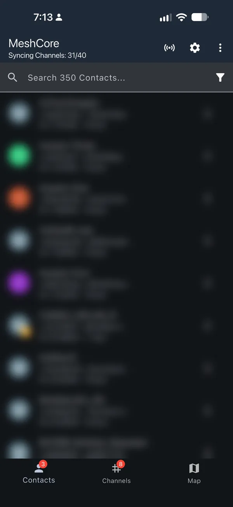
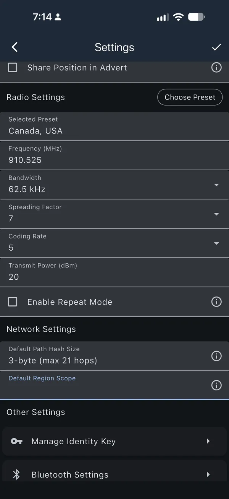
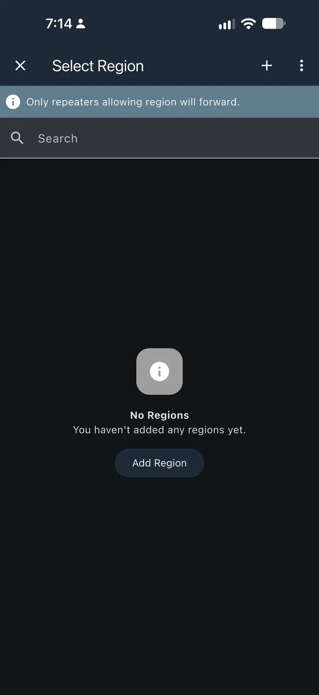
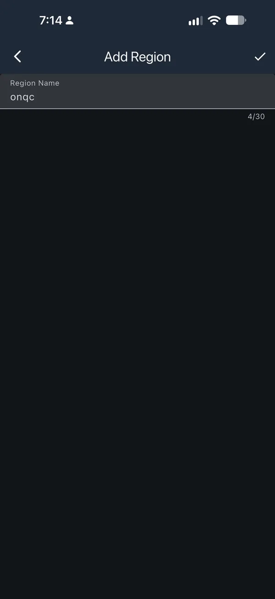
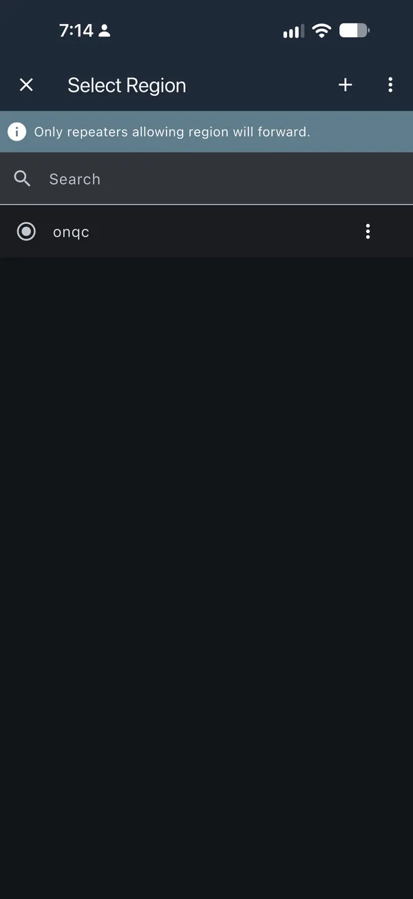
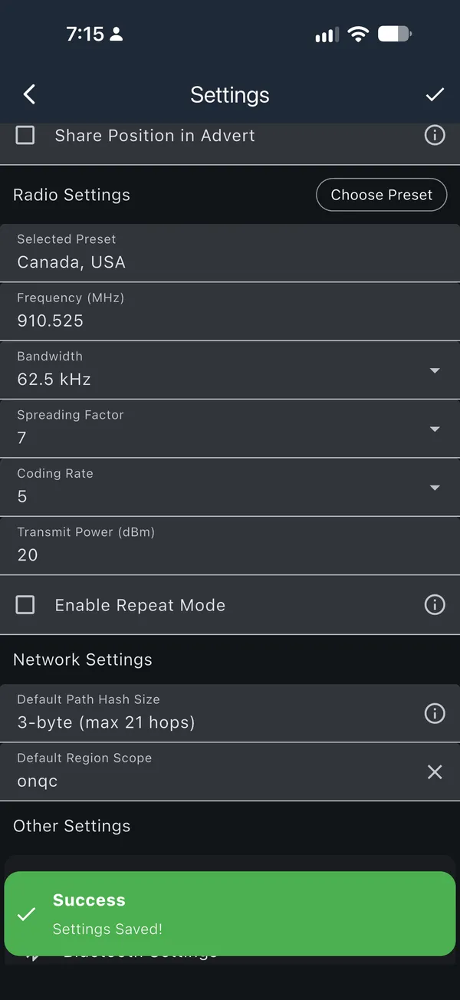

# Commencer avec un appareil compagnon

Un appareil compagnon sert à envoyer et à recevoir des messages personnels. Il
ne relaie pas le trafic des autres personnes. La plupart se jumellent à une
application; certains possèdent leur propre écran et leurs propres commandes.

[Installer et configurer un compagnon](../meshcore/flash-companion.md){ .md-button .md-button--primary }

## Avant de commencer

- Consultez les [appareils compagnons recommandés](../hardware/recommended-companions.md).
- Confirmez que le guide détaillé de reprogrammation indique votre appareil.
- Utilisez un câble USB de données et un navigateur pris en charge.
- Notez l’identité et les paramètres dont vous aurez besoin avant toute étape
  d’effacement.

## Ce qui sera modifié

Le guide lié remplace le micrologiciel de l’appareil et le configure comme
compagnon. Arrêtez-vous avant l’effacement si vous ne pouvez pas récupérer les
renseignements dont vous avez besoin.

## Installer le micrologiciel du compagnon

Suivez le guide [Installer et configurer un compagnon](../meshcore/flash-companion.md).

## Choisir les bons paramètres radio

Utilisez le préréglage **Canada** et le hachage des chemins
sur **3 octets**, sauf si votre communauté indique d’autres paramètres.

Si Canada n’apparaît pas, suivez les [consignes pour l’ancien préréglage](../provinces/index.md#canada-baseline).

!!! warning "Utilisez les mêmes paramètres que votre communauté"
    Consultez le [répertoire des communautés](../provinces/index.md). Si votre
    communauté publie d’autres paramètres, utilisez-les.

Redémarrez l’appareil après avoir modifié les paramètres radio, puis envoyez
une annonce.

## Choisir une portée (scope) {#choisir-un-scope}

!!! note "Réglez dès maintenant votre portée par défaut"
    Les répéteurs configurés avec l’[outil de configuration de meshcore.ca](../config/index.md)
    relaient les messages selon leur portée. Les répéteurs de bordure ne
    relaient pas les messages sans portée : sans portée par défaut, vos
    messages risquent de ne pas dépasser votre secteur.

    - **Ontario ou Québec :** utilisez `onqc`.
    - **Ailleurs :** utilisez le code de votre province, comme `ns` ou `bc`,
      sauf si votre communauté a convenu d’autre chose.

### La régler dans l’application MeshCore {#regler-votre-portee-par-defaut}

Il vous faut l’application MeshCore, version 1.43 ou plus récente. Les captures
d’écran utilisent `onqc`; tapez votre propre portée si vous êtes ailleurs.

1. Connectez votre appareil compagnon à l’application MeshCore et touchez la **roue des réglages** en haut à droite.

    [{ loading=lazy width="300" height="652" }](../assets/images/onqc-scopes/companion-01-connected.webp)

2. Descendez jusqu’à **Network Settings** et touchez **Default Region Scope**.

    [{ loading=lazy width="300" height="652" }](../assets/images/onqc-scopes/companion-02-settings.webp)

3. Si votre portée n’est pas dans la liste, touchez **Add Region**, ou le **+** en haut à droite.

    [{ loading=lazy width="300" height="652" }](../assets/images/onqc-scopes/companion-03-select-region.webp)

4. Tapez votre portée, tout en minuscules, et touchez le **crochet** en haut à droite.

    [{ loading=lazy width="300" height="652" }](../assets/images/onqc-scopes/companion-04-add-region.webp)

5. Touchez votre portée pour la sélectionner.

    [{ loading=lazy width="300" height="652" }](../assets/images/onqc-scopes/companion-05-pick-onqc.webp)

6. Default Region Scope affiche maintenant votre portée. Touchez le **crochet** en haut à droite. Il tourne pendant l’enregistrement, puis **Settings Saved!** apparaît.

    [{ loading=lazy width="300" height="652" }](../assets/images/onqc-scopes/companion-06-saved.webp)

Trouvez votre code de ville sur la [carte des régions IATA](../config/map.md). En Ontario et au Québec, utilisez aussi `onqc` pour le canal Public et votre code de ville, comme `yow`, pour les canaux de test : ouvrez le canal, touchez **⋮** et choisissez **Set Region Scope**. Réservez `can` et `na` à un usage futur.

Les responsables de robots et de MeshMapper suivent les [consignes pour les robots et MeshMapper](../config/guide.md#bots-and-meshmapper).

[Comprendre les répéteurs](../config/guide.md#companions) explique les portées, avec des exemples. Les portées ne changent pas les réglages radio.

## Tester l’appareil

Le compagnon est prêt lorsque :

1. l’appareil affiche les paramètres du Canada ou ceux de votre communauté;
2. un appareil fiable ou un membre de la communauté à proximité voit son annonce.

Utilisez la [liste de vérification du compagnon](verify.md#companion).

## Et ensuite?

Conservez une copie des paramètres locaux et revérifiez-les après toute
modification du micrologiciel. Consultez les
[guides pratiques de MeshCore](../meshcore/general-howto.md) pour les tâches de
messagerie courantes. [Trouvez votre communauté](../provinces/index.md), puis
échangez un message d’essai avec une personne à proximité. Si personne ne voit
l’annonce, [obtenez de l’aide](get-help.md).

<section class="mc-start-progress" data-mc-progress-page="companion" aria-labelledby="companion-progress-title">
  <h2 id="companion-progress-title">Liste de vérification</h2>
  
Cette liste est enregistrée uniquement dans ce navigateur.

  <ol>
    <li><label><input id="companion-progress-hardware" type="checkbox" data-mc-progress> Confirmer que le matériel est compatible</label></li>
    <li><label><input id="companion-progress-prepare" type="checkbox" data-mc-progress> Sauvegarder les données et préparer l’appareil</label></li>
    <li><label><input id="companion-progress-flash" type="checkbox" data-mc-progress> Suivre le guide d’installation du micrologiciel</label></li>
    <li><label><input id="companion-progress-configure" type="checkbox" data-mc-progress> Appliquer les paramètres du Canada ou de la communauté</label></li>
    <li><label><input id="companion-progress-verify-local" type="checkbox" data-mc-progress> Vérifier l’appareil à proximité</label></li>
    <li><label><input id="companion-progress-verify-community" type="checkbox" data-mc-progress> Faire un essai avec une autre personne du réseau</label></li>
  </ol>
</section>
