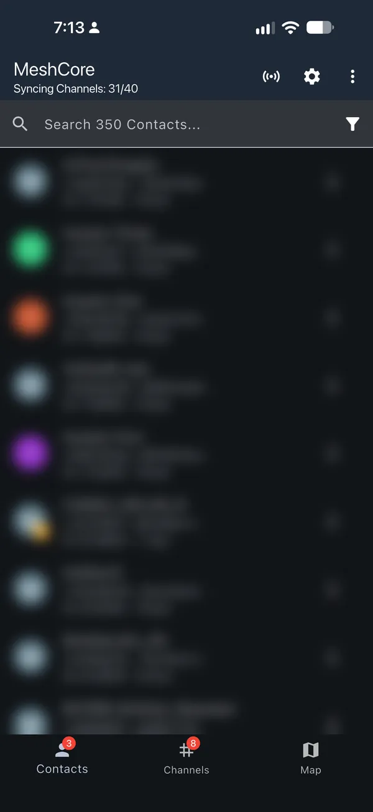
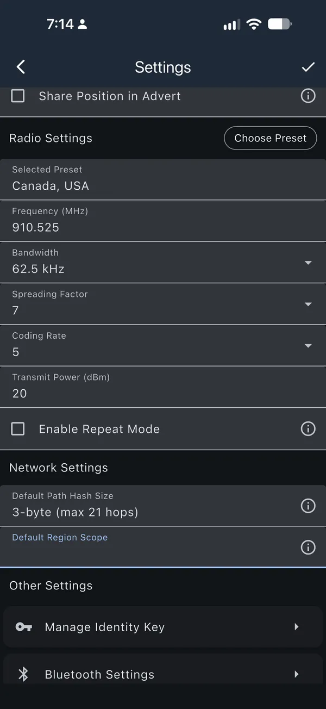
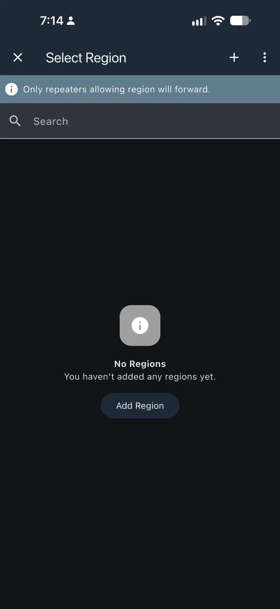
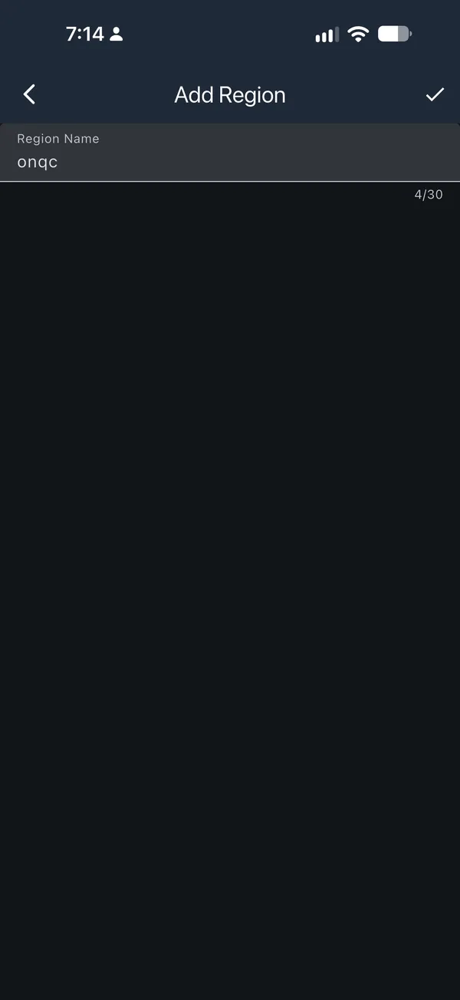
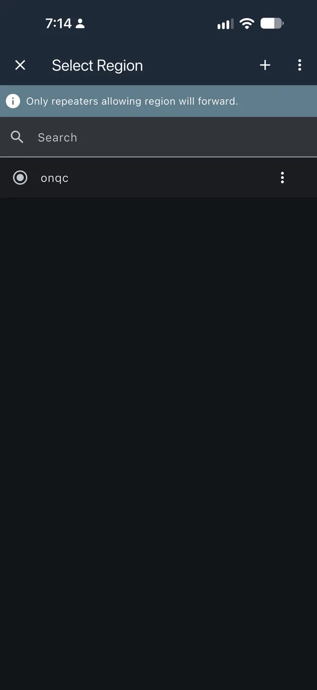
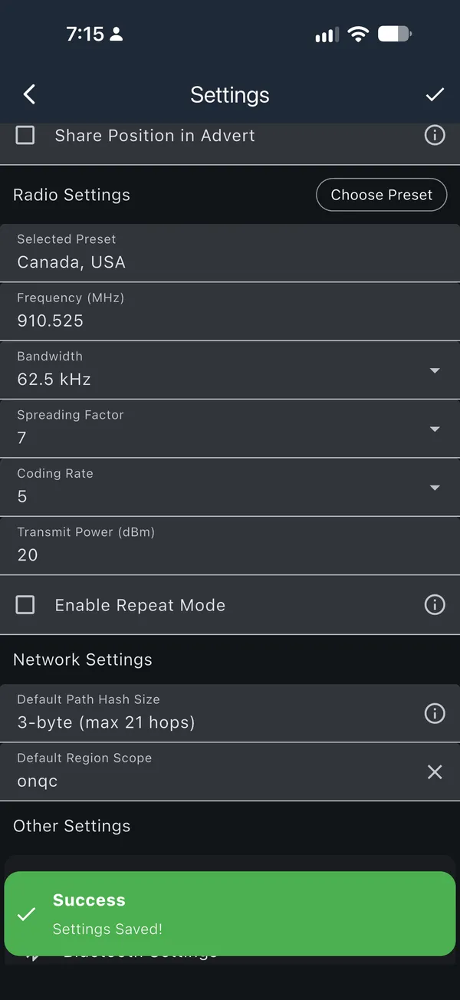

# Set up a companion

A companion is your personal MeshCore radio. It pairs with the MeshCore app on
your phone so you can send and receive messages. It doesn't relay messages for
anyone else. Setup takes about 20 to 30 minutes.

## Before you start

- **A supported device.** See the
  [recommended companions](../hardware/recommended-companions.md), and check that
  the [MeshCore flasher](https://meshcore.io/flasher) lists your exact board.
- **A USB cable that carries data.** Charge-only cables won't work.
- **Chrome or Edge on a computer.** The flasher needs
  [Web Serial](https://developer.mozilla.org/en-US/docs/Web/API/Web_Serial_API#browser_compatibility).
  Some boards also need a USB serial driver.
- **The MeshCore app** on your phone, version 1.43 or newer.

### Used this device before? Back it up first

!!! danger "Erase Flash deletes the device's stored data"
    That includes its identity (private key), name, contacts, channels and
    radio settings. An erased identity can't be recovered unless you backed it up.

1. Connect with the app that manages it now.
2. Note its name, radio settings and anything else you'd need to set again.
3. Export its private key with your app's backup option. Keep it secret: never
   post it in a screenshot, chat or issue.
4. Export contacts and channels if your app offers it.

If you can't back up something you need, **stop before Erase Flash** and
[ask for help](get-help.md).

## 1. Flash the firmware

1. Connect the device to your computer by USB.
2. Open the [MeshCore flasher](https://meshcore.io/flasher) and select your
   exact board.
3. Select **Companion Radio (Bluetooth)** and the firmware version for that board.
4. Follow the flasher's connection steps. Use **Enter DFU Mode** only if your
   board asks for it.
5. New device or deliberate reset? Back up first, then click **Erase Flash** only
   if your board's instructions require it. For an update, leave erase off.
6. Click **Flash** and wait for the completion message before unplugging.

### Check it worked

When it's done, the board restarts as a companion and the app can find it.

### Recovery if flashing fails

Don't keep erasing. Leave the device connected, refresh the flasher, put the
board back in DFU mode, select the same board and companion firmware, and try
**Flash** again. If the board no longer shows up, [ask for help](get-help.md)
before trying anything else.

## 2. Name it and set the radio

1. Open the MeshCore app and pair with your companion.
2. Give it a name that doesn't reveal where you live.
3. Check the [community directory](../provinces/index.md) for your area's
   settings. If none are listed, choose **Canada**
   (`910.525 MHz / 62.5 kHz / SF7 / CR5`) and confirm **3-byte** paths.
4. Save. The device restarts; reconnect when it's back.

Use **Canada** unless your community lists different settings. If Canada isn't
in your app, follow the [older-preset instructions](../provinces/index.md#canada-baseline).

## 3. Set your default scope {#choose-a-scope}

!!! note "Set your default scope now"
    Repeaters set up with the [meshcore.ca setup tool](../config/index.md) pass messages
    on by scope. Edge repeaters don't pass on messages that have no scope, so
    without a default scope your messages may not reach beyond your own area.

    - **Ontario or Québec:** use `onqc`.
    - **Elsewhere:** use your province's code, such as `ns` or `bc`, unless
      your community has agreed on something else.

### Set it in the MeshCore app {#set-your-default-scope}

The screenshots use `onqc`; type your own scope if you're elsewhere.

1. Connect your companion to the MeshCore app and tap the **settings cog** in the top right.

    [{ loading=lazy width="300" height="652" }](../assets/images/onqc-scopes/companion-01-connected.webp)

2. Scroll down to **Network Settings** and tap **Default Region Scope**.

    [{ loading=lazy width="300" height="652" }](../assets/images/onqc-scopes/companion-02-settings.webp)

3. If your scope is not listed, tap **Add Region**, or the **+** at the top right.

    [{ loading=lazy width="300" height="652" }](../assets/images/onqc-scopes/companion-03-select-region.webp)

4. Type your scope, all lowercase, and tap the **checkmark** in the top right.

    [{ loading=lazy width="300" height="652" }](../assets/images/onqc-scopes/companion-04-add-region.webp)

5. Tap your scope to select it.

    [{ loading=lazy width="300" height="652" }](../assets/images/onqc-scopes/companion-05-pick-onqc.webp)

6. Default Region Scope now shows your scope. Tap the **checkmark** in the top right. It spins while saving, then **Settings Saved!** pops up.

    [{ loading=lazy width="300" height="652" }](../assets/images/onqc-scopes/companion-06-saved.webp)

- Find your city code on the [Find your zone](../config/map.md) page.
- **Ontario and Québec:** also use `onqc` on the Public channel, and your city
  scope (such as `yow`) on test channels. Open the channel, tap **⋮** and choose
  **Set Region Scope**.
- Leave `can` and `na` for future use.
- Running a bot or MeshMapper? Follow the
  [bot and MeshMapper instructions](../config/guide.md#bots-and-meshmapper).

[How repeaters work](../config/guide.md#companions) explains scopes with
examples. Scopes don't change your radio settings.

## Test it

1. Send a message in the **Public** channel.
2. **Heard X Repeats** means a repeater picked it up. A plain **Sent** doesn't
   mean your settings are wrong: you may be out of range. Move somewhere with
   known coverage or ask your community to help test.
3. Reboot the companion and check that its name and settings stuck.

## What's next

- [Find your community](../provinces/index.md) and say hello.
- Learn the app with the [MeshCore how-to guides](../meshcore/general-howto.md).
- Nobody hears you? [Get help](get-help.md).
